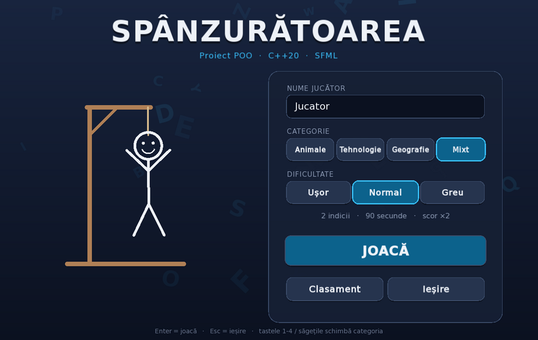
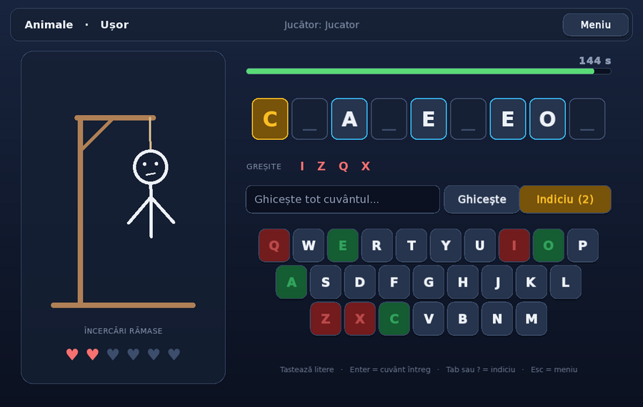
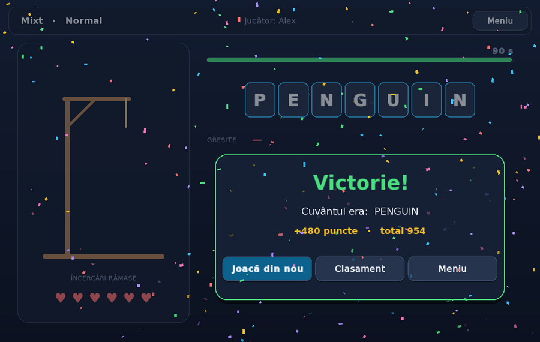
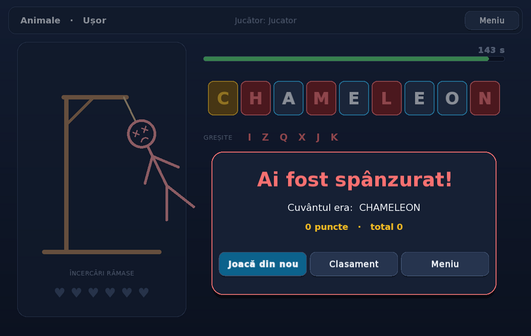
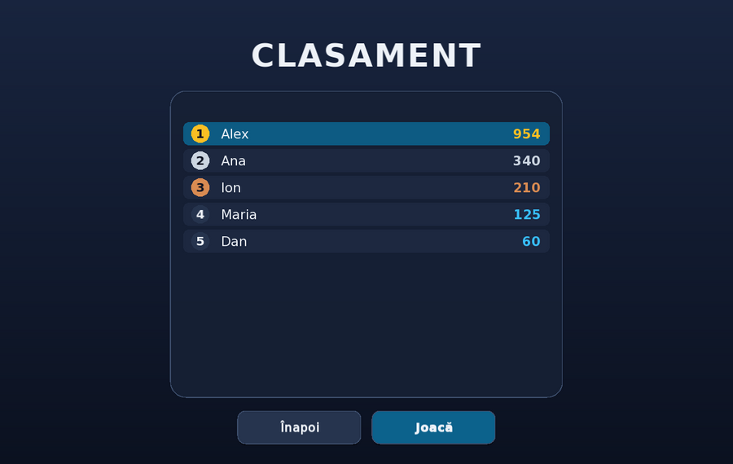

# Spânzurătoarea (Hangman) — Proiect POO în C++

Am implementat jocul Spânzurătoarea în C++20 ca proiect pentru cursul de Programare Orientată pe Obiecte. Jocul are o interfață grafică animată, construită cu SFML. Are și o variantă de consolă care folosește exact aceeași logică. Am structurat proiectul pe clase cu responsabilități clare, astfel încât fiecare concept de OOP să aibă o întrebuințare reală în cod, nu doar una demonstrativă.

Documentul are două roluri. Este documentația proiectului: cum îl compilez, cum se joacă, ce face fiecare clasă. În același timp este un material didactic: secțiunea [Conceptele de OOP folosite](#conceptele-de-oop-folosite) explică, pe codul din proiect, ce este fiecare concept și de ce l-am ales în locul alternativelor.

| Meniu | Joc |
|---|---|
|  |  |

| Victorie | Înfrângere | Clasament |
|---|---|---|
|  |  |  |

---

## Ce este nou în această versiune

Versiunea anterioară avea logica separată în headere și implementări, dar nu compila cu GCC. Interfața era doar text, iar câteva sisteme descrise în README (hint-urile care dezvăluie litere, clasamentul, timer-ul) nu erau de fapt legate de joc. În această versiune am făcut patru lucruri.

**Interfața grafică.** Am construit-o cu SFML. Are trei ecrane: meniu, joc și clasament. Fiecare element vizual (buton, tastă, căsuță de literă, figura spânzuratului) este o clasă derivată dintr-o clasă abstractă comună, `Widget`.

**Animațiile.**
- Literele cad la începutul rundei și se întorc (flip) când sunt ghicite.
- Figura se desenează segment cu segment și se balansează ca un pendul.
- La o greșeală, ecranul tremură și inima pierdută pulsează.
- Victoria aduce confetti, iar înfrângerea aduce balansul final și dezvăluirea literelor lipsă.
- Între ecrane există tranziții cu fade.

**Bug-urile.** Am lansat doi agenți de analiză („bug bounty”) pe codul vechi și am verificat fiecare problemă raportată. Lista completă, cu cauze și reparații, este în secțiunea [Buguri reparate](#buguri-reparate).

**Restul sistemelor.** Clasamentul este acum salvat pe disc, timer-ul are trei niveluri de dificultate, iar scorul se calculează pe baza performanței. Am adăugat teste automate pentru logica jocului.

---

## Compilare și rulare

Proiectul folosește CMake (minim 3.24) și un compilator cu suport C++20 (GCC 10+, Clang 12+, MSVC 2019+).

**CLion (Windows / Linux / macOS).** Deschid folderul proiectului și apăs Run pe ținta `hangman`. CMake caută întâi un SFML 2.6 instalat. Dacă nu îl găsește, îl descarcă și îl compilează automat, static, prin `FetchContent`, deci nu am nimic de instalat manual. Prima configurare durează ceva mai mult din acest motiv. Fișierele din `data/` și `assets/` sunt copiate automat lângă executabil. Jocul le găsește și când este pornit din `cmake-build-debug`, folderul în care CLion rulează programul.

**Linie de comandă.**

```bash
cmake -S . -B build -DCMAKE_BUILD_TYPE=Release
cmake --build build
./build/hangman              # interfața grafică
./build/hangman --console    # varianta text
ctest --test-dir build       # testele logicii
```

Pe Linux, cel mai simplu este să instalez SFML din managerul de pachete (`sudo apt install libsfml-dev` pe Ubuntu/Debian). Altfel, pentru compilarea automată sunt necesare headerele X11, OpenGL, udev și FreeType (`libx11-dev libxrandr-dev libxcursor-dev libxi-dev libudev-dev libgl1-mesa-dev libfreetype-dev`). Opțiunea `-DHANGMAN_BUILD_GUI=OFF` construiește doar varianta de consolă, fără nicio dependență externă.

### Controale

| Acțiune | Tastatură | Mouse |
|---|---|---|
| Ghicesc o literă | tasta literei | click pe tasta virtuală |
| Ghicesc tot cuvântul | Enter, scriu cuvântul, Enter | câmpul de text + „Ghicește” |
| Cer un indiciu | Tab sau `?` | butonul „Indiciu (n)” |
| Joc din nou / meniu | Enter / Esc | butoanele de pe panoul final |
| În meniu: categorie / dificultate | 1–4, săgeți stânga/dreapta / sus/jos | butoanele de selecție |

O literă deja încercată și caracterele care nu sunt litere nu consumă încercări. Jocul afișează doar un mesaj.

---

## Arhitectura proiectului

```
Proiect_POO-Hangman/
├── main.cpp                      alege interfața (grafică sau consolă) și o pornește
├── CMakeLists.txt
├── data/                         listele de cuvinte (un cuvânt pe linie, # = comentariu)
├── assets/fonts/                 fontul DejaVu Sans (licență liberă, inclusă)
├── tests/core_tests.cpp          teste pentru logica jocului
└── src/
    ├── headers/  +  cpp/         NUCLEUL: logica, fără nicio dependență grafică
    │   ├── Word_Manager          WordManager (abstractă) + 4 categorii + fabrica
    │   ├── Hint_Game             HintGame
    │   ├── Game, Game_Timer      regulile unei runde, cronometrul
    │   ├── scor, Leaderboard     scoruri și clasament persistent
    │   ├── User_Interface        interfața abstractă UserInterface
    │   ├── Console_UI            varianta text
    │   └── Hangman_UI            varianta grafică (fereastra, bucla, scenele)
    └── headers/ui/  +  cpp/ui/   STRATUL GRAFIC
        ├── Widgets               Widget (abstractă), Button, TextField, TimerBar, ToastStack
        ├── WordWidgets           LetterTile, WordDisplay, KeyboardKey, OnScreenKeyboard
        ├── HangmanFigure         figura desenată procedural, cu fizică de pendul
        ├── ParticleSystem        confetti
        ├── RoundedRectangleShape formă proprie derivată din sf::Shape
        └── Scene + Menu/Game/LeaderboardScene
```

Decizia de bază a arhitecturii este separarea strictă dintre **logică** (nucleul) și **afișare** (interfețele). Clasa `Game` nu scrie nimic pe ecran: primește o acțiune, aplică regulile și întoarce un rezultat (`GuessResult`). Interfața decide cum arată rezultatul: un mesaj în consolă sau o animație în fereastra grafică.

Avantajul se vede imediat. Am putut scrie a doua interfață fără să modific o singură linie din `Game`. Am putut testa logica automat, fără fereastră. Iar o eventuală a treia interfață (de exemplu cu Qt) s-ar adăuga la fel. Biblioteca `hangman_core` din CMake materializează această separare: nucleul se compilează independent, iar SFML este legat doar de executabil.

---

## Conceptele de OOP folosite

Pentru fiecare concept explic ce înseamnă, unde apare în proiect și de ce am ales această soluție.

### 1. Abstractizare și clase abstracte

O **clasă abstractă** descrie *ce* trebuie să poată face un obiect, fără să spună *cum*. În C++, o clasă devine abstractă când are cel puțin o metodă virtuală pură (`= 0`). Nu se pot crea obiecte direct din ea, ci doar din clasele derivate care implementează toate metodele pure.

În proiect folosesc patru clase abstracte, fiecare cu un rol diferit:

```cpp
class WordManager {                          // "o sursă de cuvinte"
public:
    virtual std::string getCategoryKey() const = 0;
    virtual std::string getDisplayName() const = 0;
    virtual std::string getDataFile() const = 0;
    void selectRandomWordFromCategory();      // algoritmul comun, implementat o singură dată
};

class UserInterface {                        // "ceva care poate rula jocul"
public:
    virtual int run() = 0;
};
```

`Scene` (un ecran al aplicației) și `Widget` (un element vizual) urmează același principiu. Motivul este că restul programului trebuie să depindă de abstracție, nu de detalii. `Game` lucrează cu un `WordManager` oarecare și nu știe dacă acesta citește animale dintr-un fișier sau cuvinte dintr-o listă scrisă în cod.

### 2. Încapsulare

**Încapsularea** înseamnă că starea internă a unui obiect este ascunsă și poate fi modificată doar prin metodele care îi respectă regulile. În `Game`, toate datele (cuvântul ghicit, literele încercate, încercările rămase) sunt `protected`. Din exterior, starea se schimbă doar prin `guessLetter`, `guessWord` și `useHint`, iar citirea se face prin getteri `const`, care întorc referințe constante.

```cpp
GuessResult Game::guessLetter(char letter) {
    ...
    if (!triedLetters.insert(letter).second) {
        return GuessResult::AlreadyGuessed;   // regula: repetarea nu se penalizează
    }
    ...
}
```

Fără încapsulare, orice parte a programului ar putea scrie `attemptsRemaining--` direct. Exact asta permitea versiunea veche, unde o literă repetată costa o încercare. Acum regula se află într-un singur loc și nu poate fi ocolită. `enum class GuessResult` completează încapsularea: în loc de un `bool` ambiguu, metoda comunică precis ce s-a întâmplat.

### 3. Moștenire

**Moștenirea** modelează relația „este un/o” (*is-a*): clasa derivată preia interfața și comportamentul clasei de bază și le specializează. În proiect apar trei ierarhii.

**Ierarhia categoriilor.** `AnimalWordManager`, `TechnologyWordManager`, `GeographyWordManager` și `DefaultWordManager` derivă din `WordManager`. Fiecare categorie are nevoie de doar trei linii de cod, pentru că tot algoritmul este moștenit:

```cpp
std::string AnimalWordManager::getCategoryKey() const { return "animals"; }
std::string AnimalWordManager::getDisplayName() const { return "Animale"; }
std::string AnimalWordManager::getDataFile() const { return "data/animal_words.txt"; }
```

**Ierarhia pe trei niveluri a interfeței:** `Widget → Button → KeyboardKey`. O tastă virtuală *este un* buton (are hover, click, animații), dar adaugă o stare (corectă sau greșită) și o animație de tremur. Metoda suprascrisă reutilizează explicit comportamentul clasei de bază:

```cpp
void KeyboardKey::update(float dt) {
    Button::update(dt);          // tot ce face un buton obișnuit...
    if (shakeTime > 0.f) { ... } // ...plus ce este specific tastei
}
```

**Extinderea unei clase din bibliotecă.** SFML nu are dreptunghiuri cu colțuri rotunjite. Am creat `RoundedRectangleShape : public sf::Shape` și am implementat doar două metode virtuale, `getPointCount()` și `getPoint()`. Umplerea, conturul și desenarea sunt moștenite. Este un exemplu de clasă proiectată pentru a fi extinsă: autorii SFML au lăsat exact aceste două „găuri” de completat.

### 4. Polimorfism la rulare (funcții virtuale)

**Polimorfismul** permite ca același apel să execute cod diferit în funcție de tipul *real* al obiectului, cunoscut abia la rulare. Mecanismul din C++ este funcția `virtual`, apelată prin pointer sau referință la clasa de bază.

```cpp
std::unique_ptr<UserInterface> ui;
if (!consoleMode) ui = std::make_unique<HangmanUI>();
else              ui = std::make_unique<ConsoleUI>();
return ui->run();   // legare dinamică: se apelează run() din clasa reală
```

Același mecanism îl folosește `HangmanUI` pentru ecrane. Clasa ține un `std::unique_ptr<ui::Scene>` și apelează `handleEvent`, `update` și `draw` fără să știe dacă scena activă este meniul, jocul sau clasamentul. Pentru a adăuga un ecran nou scriu o clasă derivată din `Scene`, iar bucla principală rămâne neschimbată.

Două detalii tehnice contează aici. Cuvântul cheie `override` cere compilatorului să verifice că metoda chiar suprascrie una virtuală, deci o greșeală de semnătură devine eroare de compilare, nu bug. Iar orice clasă de bază polimorfică are **destructor virtual**. Fără el, `delete` printr-un pointer la bază ar apela doar destructorul bazei, ceea ce este comportament nedefinit. Agenții de analiză au găsit exact această problemă la `Scor`, iar acum este reparată.

### 5. Compoziție în loc de moștenire

**Compoziția** modelează relația „are un/o” (*has-a*): un obiect conține alte obiecte și le folosește. Regula practică este să aleg moștenirea doar când relația *is-a* este adevărată, iar în rest compoziția.

Versiunea veche avea `class Leaderboard : public Scor`, deși un clasament *nu este* un scor, ci *conține* scoruri. Efectul era că `Leaderboard` moștenea un nume de jucător gol și o metodă `adaugaScor` fără sens. Am corectat relația:

```cpp
class Leaderboard {
    std::vector<Scor> listaScoruri;   // has-a: compoziție
    ...
};
```

Alte exemple de compoziție din proiect:
- `Game` *are* un `WordManager` și un `HintGame`.
- `WordDisplay` *are* mai multe `LetterTile`.
- `OnScreenKeyboard` *are* 26 de `KeyboardKey`.
- `GameScene` *are* un `Game`, o figură, o tastatură și restul widget-urilor.

### 6. RAII, smart pointers și semantica mutării

**RAII** (*Resource Acquisition Is Initialization*) leagă durata de viață a unei resurse de durata de viață a unui obiect: resursa este eliberată automat în destructor. În proiect nu există niciun `new` sau `delete` scris manual. Proprietatea exclusivă este exprimată prin `std::unique_ptr`:

```cpp
Game(std::unique_ptr<WordManager> manager, std::unique_ptr<HintGame> hintManager, Difficulty settings);
```

Semnătura documentează singură că `Game` *preia* proprietatea. Apelantul folosește `std::move`, iar după apel nu mai deține obiectul. Pentru că un `unique_ptr` nu poate fi copiat, am declarat explicit `Game(const Game&) = delete`, iar operațiile de mutare le-am păstrat. Obiectul poate fi deci mutat, dar nu duplicat.

Un detaliu subtil, raportat de agenții de analiză: în `Game.hpp`, clasele `WordManager` și `HintGame` sunt doar declarate anticipat (*forward declaration*), pentru a nu include headere inutile. Destructorul lui `unique_ptr<T>` are însă nevoie de tipul complet `T`. De aceea destructorul lui `Game` este declarat în header și definit în `Game.cpp` (`Game::~Game() = default;`), unde ambele tipuri sunt complete. Am aplicat aceeași tehnică la `HangmanUI` și `GameScene`.

### 7. Supraîncărcarea operatorilor

**Supraîncărcarea operatorilor** permite ca tipurile definite de mine să se comporte natural în expresii. Clasa `Scor` definește `operator>` pentru comparare și un `operator<<` prieten (`friend`) pentru afișare:

```cpp
std::stable_sort(v.begin(), v.end(), [](const Scor& a, const Scor& b) { return a > b; });
std::cout << scor;   // "Ana: 340"
```

`operator<<` este declarat `friend` pentru că operandul din stânga este `std::ostream`, nu `Scor`. Din acest motiv nu poate fi metodă membră, dar are nevoie de acces la datele protejate.

### 8. Șabloane de proiectare (design patterns)

Câteva soluții recurente din programarea orientată pe obiecte apar natural în proiect:

| Șablon | Unde | Ce problemă rezolvă |
|---|---|---|
| **Template Method** | `WordManager::selectRandomWordFromCategory()` | Algoritmul (încarcă → verifică → alege) este fix în bază. Derivatele completează doar pașii variabili. |
| **Simple Factory** | `createWordManager(Category)` | Un singur loc din program știe ce clasă concretă corespunde fiecărei categorii. |
| **Composite** | `OnScreenKeyboard`, `WordDisplay` | Un grup de widget-uri se comportă ca un singur widget (`update`, `draw`, `handleEvent` delegate copiilor). |
| **Model–View** | `Game` față de `ConsoleUI` / `GameScene` | Logica nu știe nimic despre afișare. Mai multe „vederi” folosesc același model. |
| **State** | scenele din `HangmanUI` | Comportamentul aplicației se schimbă prin înlocuirea obiectului-stare (scena activă). |

### 9. Membri statici și clase utilitare

`Random` are doar metode statice și un constructor șters (`= delete`), deci nu poate fi instanțiată. Ține un singur generator `std::mt19937`, inițializat o singură dată din `std::random_device`. Am înlocuit astfel `std::srand(time(nullptr))`, care era reapelat la fiecare construcție de `WordManager`. Cu rezoluția de o secundă a lui `time()`, mai multe porniri rapide ale jocului alegeau mereu același cuvânt. `WordManager::normalizeWord` este și ea statică, pentru că nu depinde de starea vreunui obiect.

### 10. O capcană: apelurile virtuale în constructor

În constructorul clasei de bază, obiectul derivat *nu există încă*. Un apel virtual făcut acolo ajunge la versiunea din bază, nu la cea din derivată. De aceea `WordManager` nu încarcă fișierul în constructor: ar avea nevoie de `getDataFile()`, care este virtuală. Încărcarea se face „leneș” (*lazy*), la primul apel al `selectRandomWordFromCategory()`, când obiectul este complet construit.

---

## Implementarea Componentelor

### 1. WordManager — Gestionarea Cuvintelor

**Rol:** clasă abstractă care încarcă, normalizează și alege aleatoriu cuvinte dintr-o categorie. Folosește un hash table (`std::unordered_map<std::string, std::vector<std::string>>`) de la cheia categoriei la lista de cuvinte.

**Clase derivate:** `AnimalWordManager`, `TechnologyWordManager`, `GeographyWordManager` și `DefaultWordManager`. Ultima corespunde categoriei „Mixt”: combină toate fișierele, iar dacă niciunul nu poate fi citit folosește o listă de rezervă din cod, deci jocul pornește oricum.

**Funcționalități:**
- `normalizeWord` elimină spațiile și `\r`-ul din fișierele salvate pe Windows, transformă cuvântul în litere mici și respinge liniile goale, comentariile (`#`) și caracterele neacceptate.
- Cuvintele cu spațiu sau cratimă (de exemplu „new york”) sunt acceptate. Aceste caractere sunt vizibile din start.
- Fișierele sunt căutate întâi relativ la directorul curent, apoi în folderul proiectului (`resolveResourcePath`).

### 2. HintGame — Gestionarea Hint-urilor

**Rol:** oferă hint-uri. Un hint dezvăluie o literă aleatorie care nu a fost încă ghicită.

**Funcționalități:**
- `getRandomUnrevealedLetter(secret, progress)` alege o literă de pe o poziție încă ascunsă.
- `provideHint` consumă un hint doar dacă a dezvăluit ceva. Este virtuală, deci o clasă derivată poate schimba strategia (de exemplu, să aleagă litera cea mai frecventă).
- Hint-ul se cere explicit de jucător și **nu consumă o încercare**. Numărul de hint-uri depinde de dificultate (3 / 2 / 1).

### 3. Game — Logica Jocului

**Rol:** gestionează o rundă: cuvântul, progresul, literele încercate, încercările rămase, timpul și condițiile de victorie sau înfrângere. Nu afișează nimic.

**Funcționalități:**
- `guessLetter` și `guessWord` întorc un `GuessResult`: `Correct`, `Wrong`, `AlreadyGuessed`, `Invalid` sau `GameFinished`. Literele mari sunt acceptate, iar repetările și caracterele invalide nu sunt penalizate.
- `useHint` dezvăluie o literă prin `HintGame`.
- `update` verifică expirarea timpului.
- `isGameWon`, `isGameLost`, `isGameOver` și `isTimeUp` descriu starea.
- `computeScore` calculează punctajul rundei.

**Dificultatea** este un `struct Difficulty` cu fabrici statice:

| Nivel | Greșeli permise | Hint-uri | Timp | Multiplicator scor |
|---|---|---|---|---|
| Ușor | 6 | 3 | 150 s | ×1 |
| Normal | 6 | 2 | 90 s | ×2 |
| Greu | 6 | 1 | 60 s | ×3 |

### 4. GameTimer — Cronometrul

**Rol:** măsoară timpul unei runde cu `std::chrono::steady_clock`. Acest ceas este monoton, deci nu sare dacă se schimbă ora sistemului. Timpul rămas nu mai poate fi negativ, iar `stop()` îngheață cronometrul la finalul rundei. `getRemainingFraction()` alimentează bara de timp animată.

### 5. Scor și Leaderboard — Punctaj și Clasament

**Rol:** `Scor` reține numele și punctele unui jucător. `Leaderboard` conține o listă de scoruri, prin compoziție, și o salvează în `leaderboard.txt` (format `nume;puncte`). Fișierul este reîncărcat la pornire. Punctele unui jucător se adună de la o rundă la alta.

**Calculul scorului unei runde câștigate:**

```
scor = (10 × litere distincte + 15 × încercări rămase + secunde rămase − 20 × hint-uri folosite) × multiplicator
```

Valoarea dintre paranteze are un minim de 10. O rundă pierdută aduce 0 puncte.

### 6. UserInterface, ConsoleUI și HangmanUI — Interfețele

**Rol:** `UserInterface` este interfața abstractă cu o singură metodă, `run()`. `ConsoleUI` implementează varianta text, cu citire pe linii întregi. Intrările greșite sunt cerute din nou, iar EOF închide programul curat, fără bucle infinite. `HangmanUI` implementează varianta grafică:
- deține fereastra, fonturile, clasamentul și setările;
- rulează bucla principală;
- trimite evenimentele către scena activă;
- face tranzițiile între scene.

**Detaliu de siguranță:** schimbarea scenei este *amânată* până la finalul cadrului. Dacă un buton cere „mergi la meniu”, scena curentă nu poate fi distrusă cât timp metoda butonului încă rulează, altfel s-ar produce un *use-after-free*.

### 7. Stratul grafic — Widget-uri și Scene

| Clasă | Rol |
|---|---|
| `Widget` | bază abstractă: `sf::Drawable` + `sf::Transformable` + `update` / `handleEvent` virtuale |
| `Button` | hover, apăsare, selecție, stare dezactivată, toate animate |
| `TextField` | câmp de text cu cursor care clipește lin și animație de eroare |
| `TimerBar` | bara care se golește lin și trece din verde în galben și roșu, pulsând sub 10 secunde |
| `ToastStack` | notificări temporare care intră de sus și dispar treptat |
| `LetterTile` / `WordDisplay` | căsuțele cuvântului: cădere, flip, saltul de victorie |
| `KeyboardKey` / `OnScreenKeyboard` | tastatura QWERTY virtuală, colorată după rezultat |
| `HangmanFigure` | spânzurătoarea, desenată procedural, fără imagini |
| `ParticleSystem` | confetti simulat cu gravitație și frecare |
| `MenuScene`, `GameScene`, `LeaderboardScene` | cele trei ecrane |

---

## Cum funcționează animațiile

Toate animațiile se bazează pe același principiu: la fiecare cadru, fiecare widget primește `dt`, timpul în secunde scurs de la cadrul anterior, și își avansează starea proporțional cu el. Astfel, viteza animațiilor nu depinde de numărul de cadre pe secundă. Pentru siguranță, `dt` este limitat la 1/20 s: dacă fereastra este blocată temporar, animațiile nu fac salturi.

**Easing.** O mișcare liniară arată mecanic. Funcțiile din `Style.hpp` transformă progresul liniar `t ∈ [0, 1]` într-o mișcare naturală. `outCubic` decelerează spre final. `outBack` depășește puțin ținta și revine, efectul de „arc” folosit la căderea literelor și la apariția panoului final. Pentru tranzițiile continue (hover, bara de timp) folosesc o apropiere exponențială, independentă de framerate:

```cpp
value += (target - value) * (1 - exp(-speed * dt));
```

**Flip-ul unei litere.** Scalarea pe verticală urmează `|cos(π·t)|`: scade de la 1 la 0, moment în care căsuța își schimbă fața, apoi crește înapoi la 1. Ochiul percepe efectul ca pe o rotație 3D, deși desenul este 2D.

**Pendulul.** Corpul spânzuratului se rotește în jurul punctului de prindere al frânghiei, după ecuația unui oscilator amortizat:

```cpp
acceleration = -stiffness * angle - damping * velocity;
```

Fiecare greșeală adaugă un impuls lateral. În timpul jocului, amortizarea este mare, deci balansul se stinge repede. La înfrângere, amortizarea devine aproape zero și corpul continuă să se legene.

**Confetti.** Fiecare particulă are poziție, viteză, rotație și durată de viață, iar gravitația și rezistența aerului se aplică la fiecare cadru. Toate particulele sunt desenate într-un singur apel (`sf::VertexArray`), deci sute de particule nu încetinesc jocul.

---

## Buguri reparate

Am lansat doi agenți de analiză în paralel pe codul vechi. Primul a căutat erori de compilare, comportament nedefinit și probleme de memorie. Al doilea a căutat erori de logică și de tratare a intrărilor. Fiecare problemă de mai jos a fost reprodusă (compilare sau rulare cu date de test) înainte de reparare. Reparațiile sunt acoperite de testele din `tests/core_tests.cpp` și au fost verificate cu AddressSanitizer și UndefinedBehaviorSanitizer.

| Severitate | Problemă | Cauză | Reparație |
|---|---|---|---|
| Critică | Proiectul nu compila cu GCC | membrul `Game Game;` din `HangmanUI` schimba sensul numelui `Game` în clasă | `HangmanUI` rescris complet |
| Critică | Eroare la link-are | `Hint_Game.cpp` lipsea din `CMakeLists.txt` | CMake rescris, nucleul ca bibliotecă separată |
| Critică | CMake refuza versiunile sub 3.29 | `cmake_minimum_required(VERSION 3.29)` fără motiv | minim 3.24 |
| Ridicată | Categoriile 1 și 2 nu porneau | `animal_words.txt` și `technology_words.txt` nu existau | fișiere adăugate în `data/` |
| Ridicată | Cuvintele nu erau găsite din CLion | căi relative la directorul curent (`cmake-build-debug`) | `resolveResourcePath` + copiere automată din CMake |
| Ridicată | Hint-urile nu dezvăluiau litere | erau texte fixe („Hint 1”…) afișate automat la fiecare greșeală, în ordine inversă | `HintGame` dezvăluie o literă ascunsă, la cerere |
| Ridicată | Cuvinte imposibil de câștigat | `\r` din fișierele CRLF, spații, majuscule | `normalizeWord` la încărcare |
| Ridicată | `DefaultWordManager` câștiga instant | cuvântul selectat rămânea gol, iar `"" == ""` | combină toate categoriile, cu listă de rezervă |
| Ridicată | Erorile ieșeau cu cod 0 | `catch` fără `return 1` | cod de ieșire 1 la eroare |
| Medie | Litera repetată costa o încercare | nu exista evidența literelor încercate | `std::set<char> triedLetters` + `AlreadyGuessed` |
| Medie | Cuvântul întreg era sensibil la majuscule | doar litera individuală era convertită | normalizare și pentru cuvinte |
| Medie | Intrări greșite în meniu / EOF | `std::cin >>` fără verificare | citire pe linii (`getline`) cu validare |
| Medie | `Leaderboard` derivat din `Scor`, fără destructor virtual | relație *is-a* falsă; `delete` prin bază era UB | compoziție + destructor virtual în `Scor` |
| Medie | Destructor inline cu tipuri incomplete | `~Game() = default` în header cu forward declarations | destructor definit în `Game.cpp` |
| Medie | Ordinea de inițializare diferită de cea a declarării | listele de inițializare din `Game` și `Scor` | reordonate (fără avertismente `-Wreorder`) |
| Medie | Pointeri nuli nedetectați | `Game` folosea `wordManager` fără verificare | `std::invalid_argument` în constructor |
| Scăzută | Același cuvânt la porniri rapide | `srand(time(nullptr))` la fiecare construcție | `Random` cu `std::mt19937` unic |
| Scăzută | Timp rămas negativ | lipsea limitarea la 0 | `std::max(0, …)` + timer folosit efectiv în joc |
| Scăzută | `std::tolower` pe `char` negativ | comportament nedefinit pentru octeți > 127 | conversie prin `unsigned char` |
| Scăzută | Headere fără include-urile necesare, cod mort | `Technology.hpp` gol, include-uri tranzitive | curățate |
| Scăzută | Fișiere de build în git | `cmake-build-debug/` și `.idea/` versionate | eliminate din git, adăugat `.gitignore` |

Testarea interfeței grafice a scos la iveală și un bug introdus de mine pe parcurs. Apăsarea Enter pentru a activa câmpul de cuvânt genera imediat și un caracter `'\r'`, iar câmpul gol trimis astfel își pierdea focusul. Literele tastate după aceea erau tratate ca încercări individuale. L-am reparat înainte de versiunea finală. Am reparat și un caz-limită: pe Linux fără server grafic, SFML oprește programul cu `abort()`, deci acum jocul trece automat pe varianta de consolă.

---

## Cum Extind Proiectul

**1. Adăugarea unei noi categorii** (de exemplu Sport):
1. Creez `data/sports_words.txt`.
2. Creez clasa `SportsWordManager : public WordManager`, cu cele trei metode de câte o linie.
3. Adaug `Category::Sports` și ramura corespunzătoare în `createWordManager`.
4. Adaug butonul în `MenuScene`.

`Game` și restul interfeței nu se modifică. Testele arată principiul în practică: clasa `FixedWordManager` din `tests/core_tests.cpp` extinde jocul cu o categorie nouă fără să atingă codul existent (principiul *Open/Closed*).

**2. O nouă strategie de hint:** o clasă derivată din `HintGame` care suprascrie `provideHint`.

**3. Un nou element vizual:** o clasă derivată din `Widget` care implementează `draw` și, după caz, `update` și `handleEvent`.

**4. Un nou ecran** (de exemplu Setări): o clasă derivată din `Scene` și o metodă în `HangmanUI` care o activează prin `changeScene`.

---

## TO DO

Generare de hint-uri random cu metode în clasa HintGame --DONE (hint-ul dezvăluie o literă ascunsă, la cerere)

Generarea de template-uri pentru alegerea dificultății --DONE (Ușor / Normal / Greu, prin `Difficulty`)

Clasa default pentru aria de interes a cuvintelor, dacă userul nu alege nimic --DONE (categoria Mixt, cu listă de rezervă)

Interfață grafică --DONE (SFML, cu animații)

Cleaner UI for Hints --DONE

Better interaction with the user --DONE (mesaje pentru fiecare tip de rezultat, tastatură fizică și virtuală)

Integrare Leaderboard și Game Timer --DONE

Sunete pentru literă corectă, greșeală, victorie (modulul `sfml-audio`) --TODO

Cuvinte cu diacritice românești (necesită trecerea de la `char` la `char32_t` / UTF-32 în nucleu) --TODO

Ecran de setări (volum, ecran complet, temă luminoasă) --TODO

Adaptarea interfeței la redimensionarea ferestrei --TODO

---

## Resurse

Biblioteca grafică: [SFML 2.6](https://www.sfml-dev.org/documentation/2.6.2/), licență zlib. Fontul: DejaVu Sans, licență liberă, textul complet în `assets/fonts/LICENSE-DejaVu.txt`. Pentru conceptele de C++ (funcții virtuale, smart pointers, ordinea inițializării, RAII) referința folosită este [cppreference.com](https://en.cppreference.com/), iar pentru recomandările de proiectare, [C++ Core Guidelines](https://isocpp.github.io/CppCoreGuidelines/CppCoreGuidelines).
